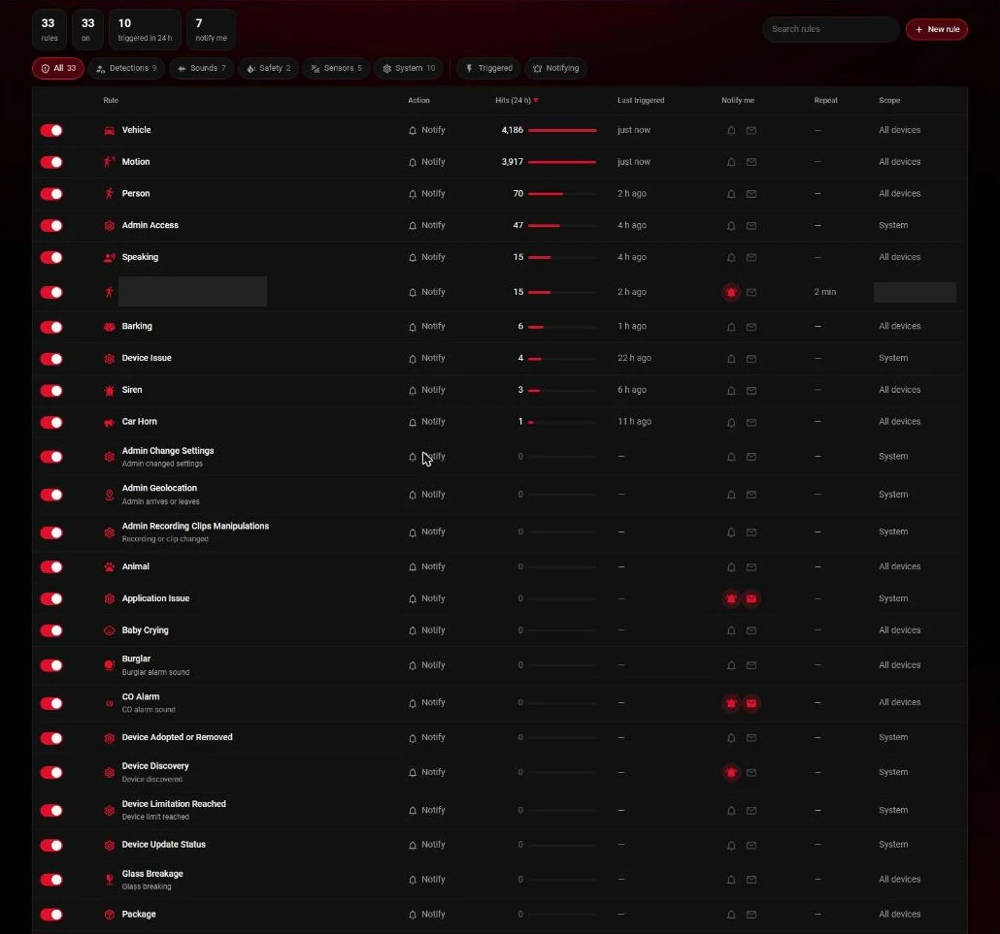

# Protect Rules

A Home Assistant custom integration for the **Alarm Manager rules** of UniFi Protect. It is a companion to Home Assistant's built-in UniFi Protect integration: it adds what that integration doesn't cover, and uses its connection, so it asks for no credentials.

- Every Alarm Manager rule becomes a switch, two sensors and an event in Home Assistant.
- The event fires the moment the rule does, so a Protect rule can trigger a Home Assistant automation.
- A dashboard card lists the rules and lets an admin add, edit and delete them.

> **It changes rules on your Protect console.** Turning a switch off disables the rule in Protect; the card creates, edits and deletes real rules. It uses the same private API as the Protect app, which Ubiquiti doesn't document and can change in any Protect update.



## Requirements

- Home Assistant 2026.11 or newer.
- The built-in **UniFi Protect** integration, set up and working.
- **[Protect Zones](https://github.com/OnticEntia/protect-zones)** installed. Protect Rules shares its live connection to Protect. It only needs to be installed, not configured.
- Optional: **[Protect Detections](https://github.com/OnticEntia/protect-detections)**. With it, the card shows a thumbnail for each time a rule fired and can play the recording.

## Installation

### HACS

1. In HACS, open the menu and choose **Custom repositories**.
2. Add `https://github.com/OnticEntia/protect-rules` with type **Integration**.
3. Install **Protect Rules** (and Protect Zones, the same way, if you don't have it).
4. Restart Home Assistant.
5. Go to **Settings → Devices & services → Add integration** and pick **Protect Rules**.

### Manual

1. Copy the `custom_components/protect_rules` folder into the `custom_components` folder of your Home Assistant configuration.
2. Install Protect Zones the same way.
3. Restart Home Assistant and add **Protect Rules** under **Settings → Devices & services**.

There is nothing to configure: one click adds it.

## What it creates

One service device, **Protect Alarm Manager**, with these entities for each rule (shown here for a rule named "Example"):

| Entity | What it is |
|---|---|
| Switch "Example" | On while the rule is enabled. Turning it off disables the rule in Protect. Its attributes describe the rule: triggers, actions, number of devices in scope, whether it has a schedule, and the cooldown. |
| Sensor "Example hits" | How often the rule fired in the last 24 hours. This is a rolling count, so it goes down as well as up. |
| Sensor "Example last fired" | When the rule last fired. |
| Event "Example fired" | Fires each time the rule does. Attributes say what set it off: `trigger`, `device`, `zones`, `detection_type`, `score`, `status` and `fired_at`. |

Rules added in Protect appear by themselves. A rule deleted in Protect loses its entities after it has been missing from a few readings in a row (about a minute and a half). Renaming a rule renames its entities' display names; entity ids stay as they are.

### Using a rule as an automation trigger

Use the rule's **fired** event entity as a state trigger. Its state is the time it last fired, so every firing is a state change.

### Action: `protect_rules.set_cooldown`

Sets how long rules stay quiet after firing. Admin users only.

| Field | Meaning |
|---|---|
| `entity_id` | One or more Protect Rules switches. |
| `enabled` | Cooldown on or off. |
| `minutes` | How long to stay quiet, 0.5 to 1440. Default 10. |

## The card

The card comes with the integration and is loaded automatically; there is no dashboard resource to add. Add it to a dashboard with:

```yaml
type: custom:protect-rules-card
```

It has no options. It is a wide table, so it works best in a panel view or a full-width section.

- One row per rule: on/off, triggers, actions, hits in the last 24 hours, last fired, push and email notifications, cooldown and scope.
- Search, category filters and sortable columns.
- A row opens the rule's details and its recent firings.
- **New rule** and **Edit** open a form like Protect's own: triggers (including several per rule and "AND" steps), schedule, device scope with zones, and actions (notify, webhook, light, PTZ).

Only Home Assistant **admin** users can use the card. Some things are still set up in Protect: drawing zones, doorbell-button rules, and sound, unlock and Slack actions. Editing a rule here keeps those parts as they are.

## Troubleshooting

- **"Protect Zones isn't installed"** when adding the integration: install Protect Zones, restart Home Assistant, try again.
- **"Set up the UniFi Protect integration first"**: the built-in integration is missing or failed to load.
- **The card says "Custom element doesn't exist"**: restart Home Assistant after installing, then reload the browser page (clear the cache if needed).
- **The card says only admin users can see the rules**: sign in as an admin.
- **"This rule was changed somewhere else since you opened it"** when saving: the rule was changed in Protect or another browser while the form was open. Cancel and edit it again.
- **No thumbnails or playback in a rule's recent firings**: those need Protect Detections.
- **Something stopped working after a Protect update**: the private API may have changed. Please open an issue with the Protect version and the Home Assistant log lines for `custom_components.protect_rules`.

For more detail in the log:

```yaml
logger:
  logs:
    custom_components.protect_rules: debug
```

## Development

The logic that needs no Home Assistant lives in `custom_components/protect_rules/logic.py` and has unit tests:

```bash
python3 -m unittest discover -s tests
```

## License

MIT. See [LICENSE](LICENSE).

This project is not affiliated with Ubiquiti or Home Assistant.
